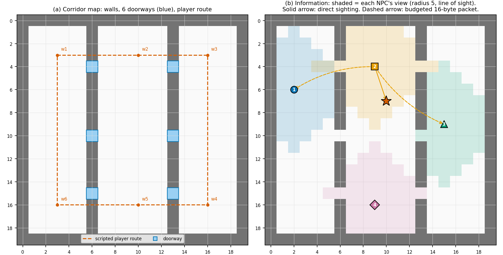
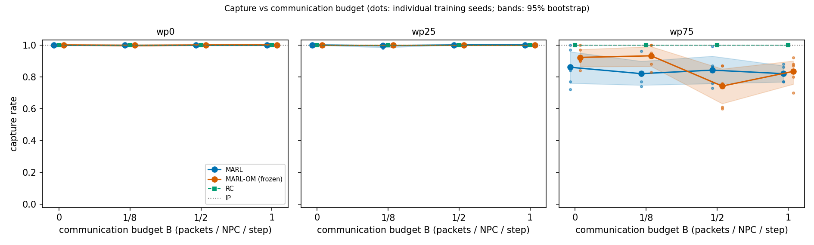
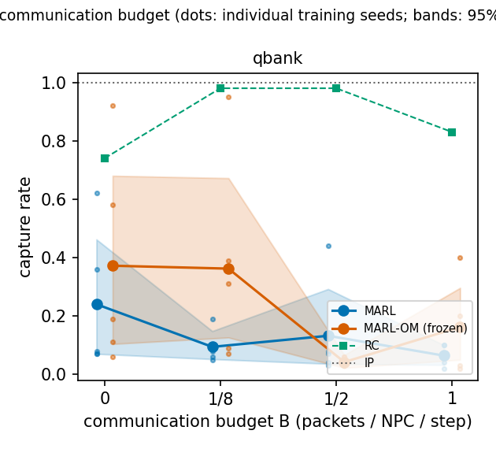
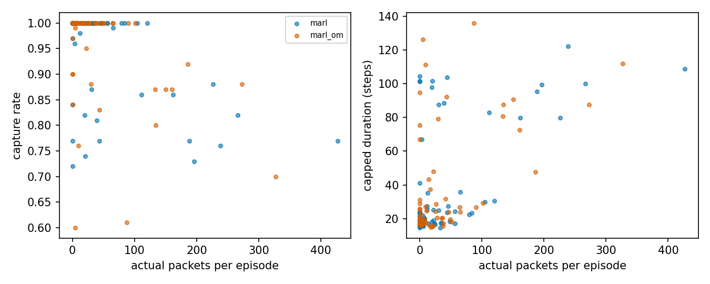
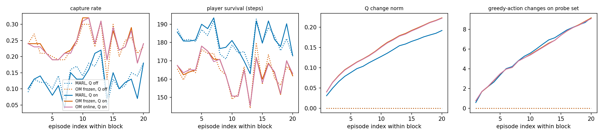
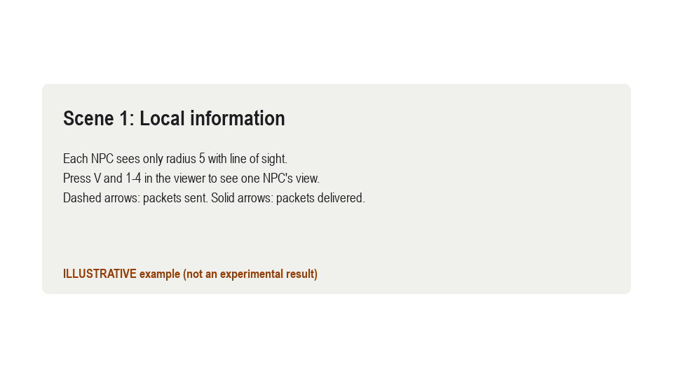
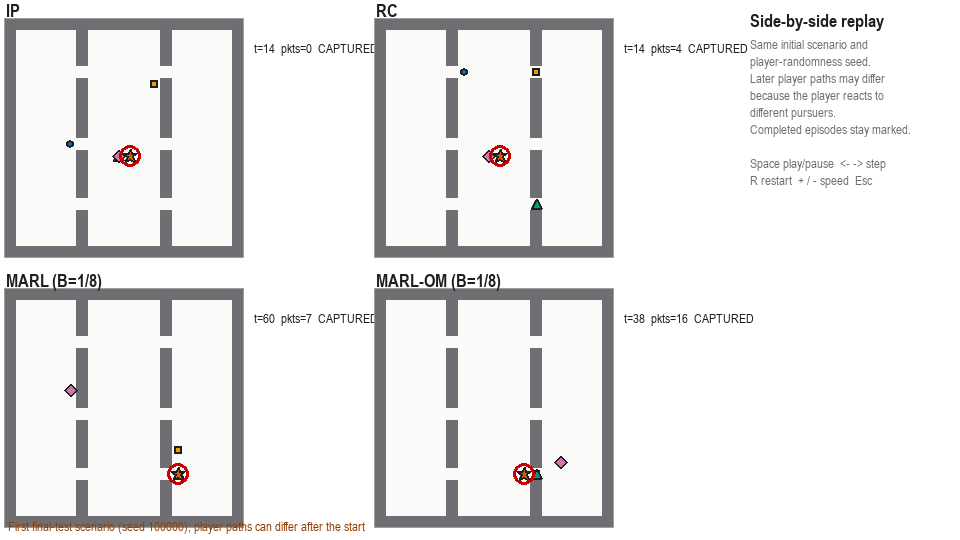
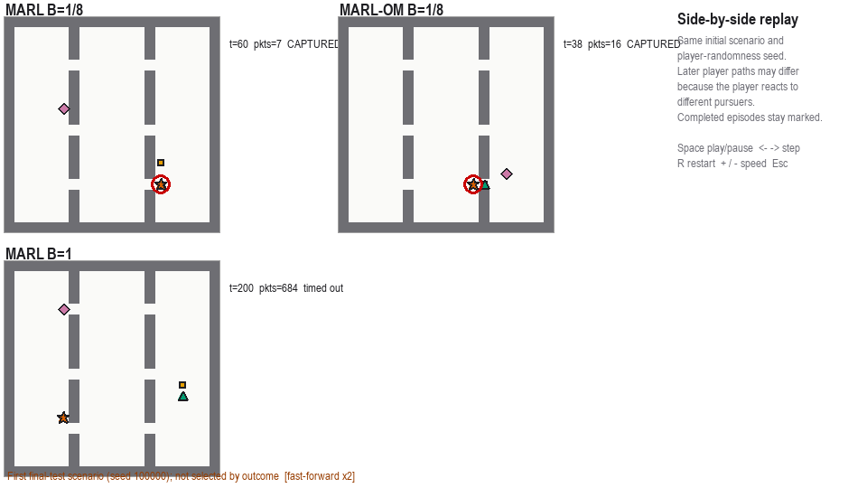
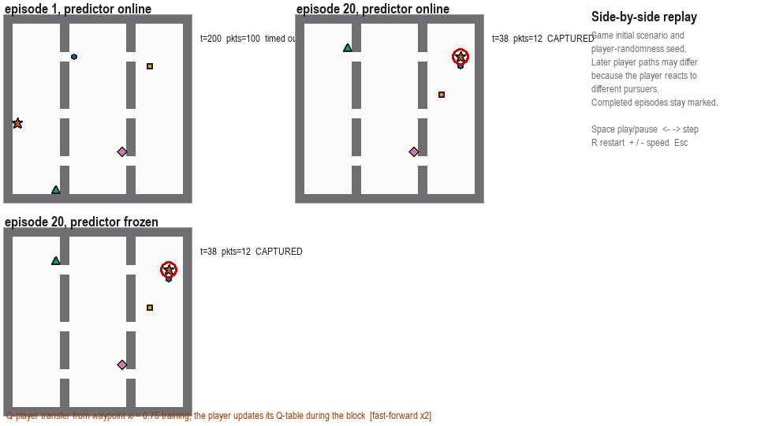

# Can opponent learning compensate for limited communication? (cooperative pursuit)

Four NPC pursuers chase one player through a 20x20 corridor map using only radius-5 line-of-sight observations and a
budgeted 16-byte broadcast channel. Four pursuers are compared: **IP** (independent pursuit), **RC** (rule-based
coordination), **MARL** (communication-constrained recurrent MAPPO) and **MARL-OM** (MARL plus a local opponent
model). Pursuers are trained against waypoint players with randomness xi in {0, 0.25, 0.75} at communication budgets
B in {0, 1/8, 1/2, 1} (120 runs, 5 seeds) and evaluated against waypoint and Q-learning players.

The full write-up is [`finalReport/report.pdf`](finalReport/report.pdf) (source `finalReport/report.tex`).

## Results at a glance



**Capture rate versus budget (waypoint player).** Dots are training seeds, bands are 95% bootstrap intervals.
At xi = 0 and 0.25 every method is at ceiling; xi = 0.75 is the only waypoint condition with headroom.



| xi = 0.75 | B = 0 | B = 1/8 | B = 1/2 | B = 1 |
| --- | --- | --- | --- | --- |
| MARL | 0.860 | 0.820 | 0.842 | 0.820 |
| MARL-OM | 0.922 | 0.932 | 0.742 | 0.834 |
| gain G = MARL-OM - MARL | +0.062 | +0.112 | -0.100 | +0.014 |
| 95% CI for G | [-0.054, 0.174] | [-0.006, 0.218] | [-0.280, 0.064] | [-0.068, 0.090] |

At B = 1/8 the five-seed sign-flip test on G gives a Holm-adjusted p = 0.56; the gain is reported as an estimate, not
a confirmed effect.

**Transfer to held-out Q-learning players** (pursuers trained at xi = 0.75, evaluated without retraining):

| | B = 0 | B = 1/8 | B = 1/2 | B = 1 |
| --- | --- | --- | --- | --- |
| MARL | 0.240 | 0.094 | 0.132 | 0.064 |
| MARL-OM | 0.372 | 0.362 | 0.042 | 0.162 |
| G | +0.132 | +0.268 | -0.090 | +0.098 |

At B = 1/8 the interval for G is [0.010, 0.584] (Holm-adjusted p = 0.19).





Additional checks reported in the paper: updating the predictor online versus keeping it frozen differs by 0.002 or
less within 20-episode blocks; a shuffled-feature control (xi = 0.75, B = 1/8) captures 0.832 versus 0.932 for MARL-OM;
ignoring delivered packets at B = 1 changes capture by about 0.01 (MARL 0.820 vs 0.828, MARL-OM 0.834 vs 0.828).

### Replay screenshots
Recorded comparison scenes (methods, budgets, learning player), shown as an annotated animation
([`evaluator_pack/demo.gif`](evaluator_pack/demo.gif), about 90 s):



Still frames from the same scenes:





## Where each number in the report comes from

Everything below is computed by `python -m pursuit.cli analyze` from the per-run CSV files saved in
`artifacts/results/` (rerunning it regenerates the tables and figures; the saved outputs are in
`artifacts/results/tables/` and `artifacts/figures/`).

| Report item | Produced from | Output |
| --- | --- | --- |
| Pilot adequacy table | `python -m pursuit.training.adequacy base 9000,9001 1200000` | `artifacts/results/pilot_adequacy_base.json` |
| IP / RC baselines | `evaluate --protocol baselines` | `artifacts/results/eval/baselines.csv` |
| Capture vs budget (waypoint), ceiling and xi = 0.75 tables | `artifacts/results/main/*/eval_frozen_waypoint.csv` | `tables/frozen_summary_waypoint.csv`, `tables/primary_hypotheses_waypoint.json`, `capture_vs_budget_waypoint` |
| Q-player transfer table | `artifacts/results/main/*/eval_player_cells.csv` | `tables/frozen_summary_player.csv`, `tables/primary_hypotheses_player.json` |
| Adaptive / online predictor | `eval_player_cells.csv`, `eval_matched_diagnostic.csv` | `tables/adaptive_first_last.csv`, `adaptive_curves` |
| Actual packets and duration | `eval_frozen_waypoint.csv` | `packets_vs_capture` |
| Shuffled-feature control | `artifacts/results/secondary/*` | `tables/shuffle_control.csv` |
| Message-reliance diagnostic | `evaluate --protocol reliance` -> `eval_reliance.csv` | `tables/reliance_summary.csv`, `tables/reliance_by_seed.csv` |
| Task calibration | `python -m pursuit.evaluation.calibration OUT.csv N` | `artifacts/results/calibration_tasks/`, `docs/pilot_report.md` |

Model checkpoints and per-run training episode logs are not stored in the repository (large binaries). The saved
evaluation CSVs, run metadata (`meta.json`), validation results (`val.json`) and training curves (`train_log.json`) for
all 120 main runs and the 10 control runs are included under `artifacts/results/main/` and `artifacts/results/secondary/`.
To regenerate the checkpoints, run the training and evaluation commands below.

## Install and smoke-test (Python 3.12)
```powershell
python -m venv .venv --system-site-packages   # reuse an installed CUDA torch wheel; or install torch yourself
.\.venv\Scripts\python -m pip install -r requirements-lock.txt
.\.venv\Scripts\python -m pip install -e . --no-deps
.\.venv\Scripts\python -m pursuit.cli check
.\.venv\Scripts\python -m pytest -q
```
Smoke runs are pipeline checks, not reproductions of the scientific results.

## Reproducing the experiments
```powershell
python -m pursuit.cli train-player                          # Q-learning player bank (seeds 7000-7002, 7100-7104)
python -m pursuit.cli train --workers 12 --gpus 0,1         # 120 main runs + 10 control runs (resumable, 1.2M steps each)
python -m pursuit.cli evaluate --protocol baselines
python -m pursuit.cli evaluate --protocol frozen_waypoint --workers 4
python -m pursuit.cli evaluate --protocol adaptive --workers 4
python -m pursuit.cli evaluate --protocol reliance --workers 4
python -m pursuit.cli analyze                               # tables and figures
python -m pursuit.cli scenes                                # comparison scenes 1-4 for the replay viewer
python -m pursuit.cli export-demo                           # demo.gif and keyframes
```
Training the 120 main runs is long (MARL about 40 minutes, MARL-OM about 2.4 hours per run, many runs in parallel).
Completed runs are immutable (`status.json`); a changed implementation or config needs a new run ID.

## Commands (`python -m pursuit.cli COMMAND`)
| command | purpose |
| --- | --- |
| check | validate maps, run a smoke episode and the PettingZoo API test |
| render-map | map + information diagram (PNG/PDF) |
| train-player | train the Q-learning player bank |
| pilot | validation pilot (`--total-steps`, `--shaping`, `--pilot-seeds`) |
| train | main/secondary manifest runs (`--run-ids pattern,...`) |
| evaluate | `--protocol baselines`, `frozen_waypoint`, `adaptive` or `reliance` |
| analyze | tables, bootstrap intervals, figures from saved CSVs |
| scenes | record comparison scenes 1-4 |
| demo | interactive replay viewer (`--replay DIR_OR_FILE`) |
| export-demo | GIF + keyframes from recorded replays |

Manifest: `python -m pursuit.training.manifest STEPS` writes `configs/final_manifest.json`.

## Interactive viewer
`evaluator_pack/launch_demo.ps1` opens the replay viewer (Space play/pause, Left/Right step, R restart, 1-4 NPC
perspective, V evaluator/NPC view, M message arrows, P belief heatmap, +/- speed, Tab next replay, Esc exit).

## Layout
`src/pursuit/{env,opponents,controllers,models,training,evaluation,rendering}`, `configs/`, `maps/`, `docs/`, `tests/`,
`artifacts/{results,figures}`, `evaluator_pack/`, `finalReport/`. See `docs/` for the environment contract,
experiment protocol, pilot report and requirements traceability.
